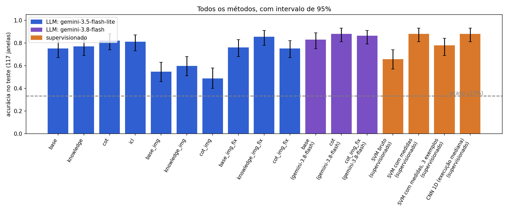

# Reproduzindo o Wi-Chat: LLMs reconhecendo atividades humanas a partir de sinais de Wi-Fi

Trabalho final da disciplina **INF0375 – Tópicos em Computação** (UFG, 2026.2).
Autor: Anderson Barros Rigonatto

Este repositório reproduz os experimentos do artigo:

> H. Zhang, Y. Ren, H. Yuan, J. Zhang, Y. Shen. **Wi-Chat: Large Language Model Powered Wi-Fi Sensing.** arXiv:2502.12421, 2025.

O artigo propõe usar um LLM para reconhecer a atividade de uma pessoa (caminhar, cair, respirar ou nada) **sem nenhum treino** (zero-shot), apenas mostrando o sinal de Wi-Fi como texto ou imagem e explicando a física do sinal no prompt.

## Resumo dos resultados

| Pergunta do artigo | Artigo (GPT-4o, 4 classes) | Esta reprodução (Gemini, 3 classes) | Repetiu? |
|---|---|---|---|
| O LLM classifica sem treino? | 62% | 75% a 88% (acaso: 33%) | ✅ Sim |
| Exemplos no prompt (ICL) ajudam? | 62% → 77% | 75% → 81% | ✅ Sim |
| A física no prompt ajuda? | ajuda | pouco no texto, muito na imagem | 🟡 Em parte |
| Raciocínio em passos (CoT) piora com texto? | piora | melhora: 75% → 82% | ❌ Não |
| Imagem é melhor que texto? | sim (90%) | só com escala fixa no gráfico (86% vs. 77%) | 🟡 Depende |
| O LLM fica abaixo dos métodos treinados? | sim (90% vs. 98–100%) | empatou: 88,0% vs. 88,0% | ❌ Não |

**Principais achados:**

1. A ideia central se reproduz: um LLM sem treino reconhece atividades pelo Wi-Fi muito acima do acaso.
2. **A escala do gráfico muda tudo.** Com escala automática, o modelo quase nunca reconhecia "no event" (49–60% de acurácia); com a mesma escala vertical para todos os gráficos, a acurácia subiu para 75–86%. O artigo não descreve como gerou as imagens.
3. O melhor LLM (Gemini 3.8 Flash com CoT, sem treino) **empatou** com os melhores métodos supervisionados (SVM com medidas de variação e CNN 1D, treinados com 273 exemplos).



### Tabela completa (117 janelas de teste, intervalo de confiança de 95%)

| Método | Modelo / tipo | Treino | Acurácia | IC 95% | F1 macro |
|---|---|---|---|---|---|
| base | Gemini 3.5 Flash-Lite | nenhum | 0,752 | 0,67–0,82 | 0,749 |
| knowledge | Gemini 3.5 Flash-Lite | nenhum | 0,769 | 0,69–0,84 | 0,763 |
| cot | Gemini 3.5 Flash-Lite | nenhum | 0,821 | 0,74–0,88 | 0,819 |
| icl | Gemini 3.5 Flash-Lite | 3 exemplos no prompt | 0,812 | 0,73–0,87 | 0,806 |
| base_img | Gemini 3.5 Flash-Lite | nenhum | 0,547 | 0,46–0,63 | 0,515 |
| knowledge_img | Gemini 3.5 Flash-Lite | nenhum | 0,598 | 0,51–0,68 | 0,513 |
| cot_img | Gemini 3.5 Flash-Lite | nenhum | 0,487 | 0,40–0,58 | 0,406 |
| base_img_fix | Gemini 3.5 Flash-Lite | nenhum | 0,761 | 0,68–0,83 | 0,757 |
| knowledge_img_fix | Gemini 3.5 Flash-Lite | nenhum | 0,855 | 0,78–0,91 | 0,856 |
| cot_img_fix | Gemini 3.5 Flash-Lite | nenhum | 0,752 | 0,67–0,82 | 0,739 |
| base | Gemini 3.8 Flash | nenhum | 0,829 | 0,75–0,89 | 0,829 |
| cot | Gemini 3.8 Flash | nenhum | 0,880 | 0,81–0,93 | 0,881 |
| cot_img_fix | Gemini 3.8 Flash | nenhum | 0,863 | 0,79–0,91 | 0,862 |
| SVM bruto | supervisionado | 273 janelas | 0,658 | 0,57–0,74 | 0,665 |
| SVM com medidas | supervisionado | 273 janelas | 0,880 | 0,81–0,93 | 0,880 |
| SVM com medidas | supervisionado | 3 janelas (as do ICL) | 0,778 | 0,69–0,84 | 0,770 |
| CNN 1D (média de 5 execuções: 0,872 ± 0,014) | supervisionado | 273 janelas | 0,880 | 0,81–0,93 | 0,879 |

Sufixo `_img`: o prompt inclui o gráfico da série com escala vertical automática. Sufixo `_img_fix`: mesma escala vertical para todos os gráficos.

## Dados

Usamos o dataset público de **Alsaify et al. (2020)**, porque os dados do artigo original não são públicos:

> B. A. Alsaify, M. M. Almazari, R. Alazrai, M. I. Daoud. A dataset for Wi-Fi-based human activity recognition in line-of-sight and non-line-of-sight indoor environments. *Data in Brief* 33, 106534, 2020. Dados: Mendeley Data, doi:[10.17632/v38wjmz6f6.1](https://doi.org/10.17632/v38wjmz6f6.1). Licença CC BY 4.0.

- Mesma placa do artigo (Intel 5300, Linux 802.11n CSI Tool), 30 pessoas, 3 ambientes.
- 2,4 GHz, 20 MHz, 320 pacotes/s, 1 × 3 antenas, 30 subportadoras.
- Não tem respiração, por isso usamos 3 classes: `walk`, `fall` e `no event` (pessoa parada).

**Cópia dos dados para reprodutibilidade:** como bases públicas de Wi-Fi já desapareceram durante este trabalho (o UT-HAR, planejado inicialmente, teve o link removido), mantemos uma cópia na [página de Releases](../../releases) deste repositório, redistribuída sob a licença CC BY 4.0 com a citação acima:

| Arquivo | Conteúdo |
|---|---|
| `alsaify_bruto_environment1.zip`, `..._environment2.zip`, `..._environment3.zip` | dataset original, como baixado do Mendeley (um zip por pessoa) |
| `alsaify_processado.zip` | as 390 janelas usadas aqui (`alsaify_segmentos.npz`, `alsaify_meta.csv`, `alsaify_params.json`) |
| `imagens.zip` | os gráficos enviados ao LLM (escala automática e fixa) |

## Metodologia

**1. Janelas de 5 s (notebook 01).** As atividades do dataset duram 3–5 s e são contínuas dentro de cada gravação (~3 ms entre partes), então as emendamos e recortamos janelas de 5 s (1600 pacotes):
- `walk`: os 5 s do meio do experimento de caminhada;
- `fall`: 1 s antes da queda, a queda inteira e o início de "deitado";
- `no event`: trecho "sentado parado" (4,85 s), completado com em média 0,12 s do início da atividade seguinte, só quando esse trecho é estável.

São 130 janelas por classe (390 no total), divididas em 70/30, estratificado, com semente 42: **273 de treino e 117 de teste**.

**2. Do sinal ao prompt (notebook 02).**
- Série única: média da amplitude das 90 séries (3 antenas × 30 subportadoras). Não usa os rótulos.
- Filtro Savitzky-Golay (janela 31, ordem 3) e subamostragem para 100 pontos (20 por segundo).
- Texto: os 100 valores com 1 casa decimal. Imagem: gráfico de linha 800 × 300 px.
- Prompts do Apêndice A do artigo, adaptados para 3 classes: `base`, `knowledge`, `cot`, `icl` (3 exemplos, a janela de treino mais típica de cada classe) e as versões com imagem.
- Gemini 3.5 Flash-Lite, temperatura 0, via API (Google AI Studio, novembro de 2026).

**3. Experimentos extras (notebook 03).**
- Gráficos com escala vertical fixa (mesma altura para todos, cobrindo 99% das janelas de treino).
- Modelo maior: Gemini 3.8 Flash em `base`, `cot` e `cot_img_fix`.
- Métodos supervisionados: SVM (RBF) com os valores brutos; SVM com 4 medidas de variação (desvio-padrão, amplitude, variação média e máxima entre pontos vizinhos); SVM com só os 3 exemplos do ICL; CNN 1D (Adam, lr 0,001, 30 épocas, lote 32, 5 execuções).

## Estrutura do repositório

```
notebooks/
  01_dados_alsaify.ipynb        recorte das janelas e validação
  02_prompts_e_gemini.ipynb     representações, prompts e rodada principal
  03_experimentos_extras.ipynb  escala fixa, modelo maior e métodos treinados
prompts/
  prompts_teste.jsonl           as 819 perguntas enviadas ao LLM
resultados/
  respostas_gemini.jsonl        respostas do notebook 02 (texto completo de cada resposta)
  respostas_extras.jsonl        respostas do notebook 03
  tabela_final.csv              tabela de resultados
  grafico_final.png             gráfico de resultados
```

As respostas dos LLMs estão salvas porque os modelos comerciais mudam com o tempo: rodar de novo pode não dar exatamente os mesmos números.

## Como reproduzir

1. Baixe os dados da página de Releases (ou do Mendeley) e coloque-os no seu Google Drive.
2. Abra os notebooks no Google Colab, em ordem. Na primeira célula de cada um, ajuste a variável `MATERIA` (ou `PROJ`) para a pasta onde estão os dados.
3. Para os notebooks 02 e 03, crie uma chave em [aistudio.google.com/apikey](https://aistudio.google.com/apikey) e salve-a nos *Secrets* do Colab como `GEMINI_API_KEY`. O plano gratuito tem limite diário baixo; rodamos com crédito pré-pago, num custo total de cerca de [R$ 30].
4. Todas as respostas são salvas à medida que chegam: se a execução parar, basta rodar a célula de novo.

## Limitações

- Outro dataset e 3 classes em vez de 4; "no event" é uma pessoa parada, não a sala vazia.
- Gemini no lugar do GPT-4o: os números não se comparam um a um com os do artigo.
- Teste com 117 janelas: intervalos de cerca de ±7 pontos; diferenças pequenas entre estratégias são tendências.
- Várias decisões (série média, 100 pontos, escala do gráfico) são nossas, porque o artigo não as especifica, e o experimento da escala mostrou que elas podem mudar o resultado em mais de 20 pontos.

## Trabalhos futuros

- Claude e modelos abertos (Llama, Gemma, Mistral, Qwen-VL).
- Dados sintéticos gerados pelo modelo físico do artigo, incluindo respiração.
- Métodos clássicos completos do artigo (CARM, E-eyes).

## Licenças

- Código e notebooks: [MIT](LICENSE).
- Dados: CC BY 4.0, de Alsaify et al. (2020); cite o trabalho original ao usá-los.
